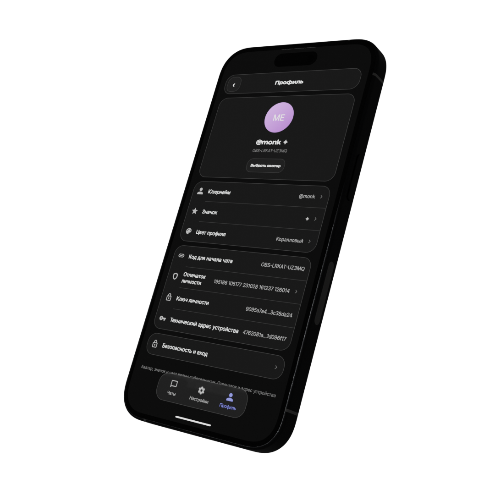

<a id="top"></a>

<div align="center">


<h1>Переписка на ваших условиях.</h1>

<p>Мессенджер для Android и Windows.<br />Сквозное шифрование, собственные ключи и общее ядро на Rust.</p>

<p>
  <a href="https://github.com/ifny75/valanium_android"></a>
  <a href="https://github.com/ifny75/valanium_pc"></a>
  <a href="ARCHITECTURE.md"></a>
  <a href="LICENSE"></a>
</p>

<p>
  <a href="#features">Возможности</a> &nbsp; · &nbsp;
  <a href="#clients">Клиенты</a> &nbsp; · &nbsp;
  <a href="#development">Разработка</a> &nbsp; · &nbsp;
  <a href="ARCHITECTURE.md">Архитектура</a>
</p>

</div>

<br />

<a id="features"></a>

## Общение. Ключи. Контроль.

<table>
<tr>
<td colspan="2" valign="top">
<h3>Сквозное шифрование</h3>
<p>Личные сообщения и группы шифруются на устройстве через <b>MLS / OpenMLS</b>. В очереди релея хранятся зашифрованные конверты.</p>
</td>
</tr>
<tr>
<td width="50%" valign="top">
<h3>Собственные ключи</h3>
<p>Личность и устройства используют <b>Ed25519</b>. Для восстановления личности предназначена секретная фраза из 24 слов.</p>
</td>
<td width="50%" valign="top">
<h3>Выбор доступа</h3>
<p>Onion-доставка, пропуска для входящих сообщений и локально запечатанная история. Настройки и ключи находятся в общем Rust-ядре.</p>
</td>
</tr>
</table>

<a id="clients"></a>

## Два клиента. Одно ядро.

<table>
<tr>
<td width="50%" align="center" valign="top">
<br />
<h3>Android</h3>
<p>Нативный Java-интерфейс, Android Keystore<br />и встроенный Tor.</p>
<a href="valanium-android/README.md"><b>Сборка Android →</b></a>
</td>
<td width="50%" align="center" valign="top">
<br />
<h3>Windows</h3>
<p>Tauri 2, WebView2<br />и прямая линковка Rust-ядра.</p>
<a href="valanium-windows/README.md"><b>Сборка Windows →</b></a>
</td>
</tr>
</table>

<p align="center"><sub>Визуальные концепты проекта. Интерфейс и возможности зависят от версии сборки.</sub></p>

<a id="docs"></a>

## Устройство проекта

<table>
<tr>
<td colspan="2" valign="top">
<h3>Архитектура</h3>
<p>Границы доверия, компоненты, ключи и протокол.<br /><br /><a href="ARCHITECTURE.md"><b>Читать архитектуру →</b></a></p>
</td>
</tr>
<tr>
<td width="50%" valign="top">
<h3>Доставка через Tor</h3>
<p>Одноразовые соединения, очередь, повторы и ограничения.<br /><br /><a href="docs/delivery-latency.md"><b>Разобраться в доставке →</b></a></p>
</td>
<td width="50%" valign="top">
<h3>Свой сервер</h3>
<p>Конфигурация релеев, nginx, WireGuard и systemd.<br /><br /><a href="deploy/README.md"><b>Открыть руководство →</b></a></p>
</td>
</tr>
</table>

<a id="development"></a>

## Начать разработку

Команды выполняются из корня репозитория:

```bash
# Rust-ядро
cargo test --manifest-path valanium-core/Cargo.toml --lib

# Сервер: Node.js >= 24
(cd valanium-server && npm ci --ignore-scripts && npm run check && npm test)

# Windows: Windows + Rust + MSVC + WebView2
(cd valanium-windows && npm ci && npm test && npm run build)

# Android: JDK 17+, SDK 35, NDK и cargo-ndk
(cd valanium-android && ./gradlew :app:assembleDebug)
```

Точные требования — в README соответствующего компонента. `npm run build`
у Windows-клиента использует `--no-bundle`: это сборка приложения, а не MSI/NSIS.
APK release требует отдельной корректной подписи; ключи подписи не хранятся в коде.

Интеграционные тесты ядра находятся в `valanium-core/tests`. Тест старого
восстановления по паролю пока несовместим с текущим режимом `seed_only`;
его ошибка воспроизводится и без изменений доставки. Проверки на настоящем
Tor, сборка APK и нативная сборка Windows нужны отдельно от модульных тестов.

<details>
<summary><b>Карта каталогов</b></summary>

| Каталог | Содержимое |
| --- | --- |
| [valanium-core](valanium-core) | MLS, ключи, запечатанная SQLite, протокол и очередь доставки |
| [valanium-android](valanium-android) | Нативный Java-интерфейс, JNI, Android Keystore и встроенный Tor |
| [valanium-windows](valanium-windows) | Tauri 2, WebView2 и прямая линковка Rust-ядра |
| [valanium-server](valanium-server) | TypeScript, Node.js 24+, uWebSockets.js и SQLite |
| [deploy](deploy/README.md) | Развёртывание релеев и основного сервера |
| [valanium-site](valanium-site) | Публичный сайт |
| [valanium-onionize](valanium-onionize) | Компонент Tor для настольного клиента |
| [valanium-vpn-main](valanium-vpn-main) | Отдельный VPN-проект со своей архитектурой |

</details>

<a id="privacy"></a>

## Приватность и её границы

Серверу видны адрес получателя, размер и время конверта. При AUTH видна
личность соединения. Tor не исключает корреляцию по времени и не защищает
скомпрометированное устройство. Открытые каналы и поддержка имеют отдельную
модель хранения. Перед чувствительной перепиской сверяйте отпечатки ключей
по независимому каналу.

<details>
<summary><b>Подробнее: ключи, анонимная очередь и пропуска</b></summary>

- Личность и устройства используют Ed25519. Для восстановления личности
  предназначена секретная фраза из 24 слов; сервер её не получает.
- Локальные записи запечатаны XChaCha20-Poly1305. Ключ базы и механизм его
  хранения зависят от платформы; на Android используется Keystore.
- В анонимном режиме сообщение уходит через одноразовое onion-соединение
  без AUTH. Заранее готовятся до двух одноразовых сокетов; каждый
  расходуется только на одно сообщение. Ошибка не включает резервный SEND через AUTH.
- Повторы назначаются отдельно для конвертов через 2, 4 и затем 8 секунд,
  без ожидания heartbeat. Шифротекст сохраняется; порядок внутри одного
  получателя не меняется. Tor по-прежнему может устанавливать связь медленно.
- Ограничение входящих по пропускам впервые включается после взаимного
  обмена пропусками. При незавершённом обмене настройки не меняются.
  Уже заблокированным без пропусков контактам нужны приглашения вне чата.

</details>

<a id="ecosystem"></a>

## Экосистема Valanium

<table>
<tr>
<td width="50%" valign="top">
<strong><a href="https://github.com/ifny75/valanium_main">Valanium Core</a></strong><br />
<sub>Rust-ядро, протокол и все компоненты проекта.</sub>
</td>
<td width="50%" valign="top">
<strong><a href="https://github.com/ifny75/valanium_server">Valanium Server</a></strong><br />
<sub>WebSocket-релей, очередь и развёртывание.</sub>
</td>
</tr>
<tr>
<td valign="top">
<strong><a href="https://github.com/ifny75/valanium_android">Valanium для Android</a></strong><br />
<sub>Java-интерфейс, JNI и встроенный Tor.</sub>
</td>
<td valign="top">
<strong><a href="https://github.com/ifny75/valanium_pc">Valanium для Windows</a></strong><br />
<sub>Tauri 2, WebView2 и общее Rust-ядро.</sub>
</td>
</tr>
</table>

В отдельных клиентах Rust-ядро закреплено по SHA в `Cargo.toml` и `Cargo.lock`.
В этом дереве используется локальная зависимость. Версии интерфейсов могут
различаться: исправления нужно переносить в обе копии и проверять отдельно.
Публикация исходников сама по себе не обновляет сервер и установленные клиенты.

<a id="license"></a>

## Лицензия

[GNU Affero General Public License v3.0](LICENSE).
Авторские права — [COPYRIGHT](COPYRIGHT). Условия использования названия и
знаков описаны в [TRADEMARK.md](TRADEMARK.md); зависимости сохраняют свои лицензии.

<div align="center">
<sub>Valanium · Android · Windows · Rust</sub><br />
<a href="#top">Вернуться к началу ↑</a>
</div>
