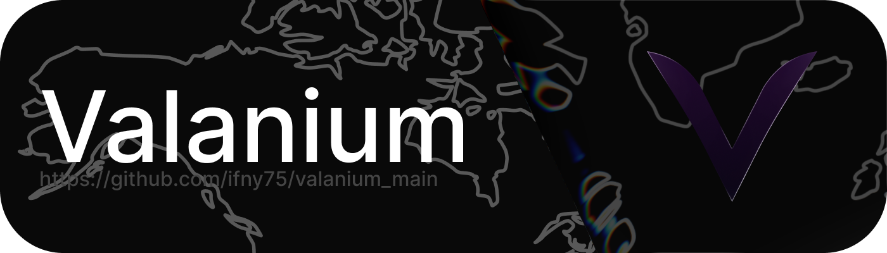

<div align="center">
  
</div>

# Valanium для Windows

Tauri 2 и WebView2 для интерфейса, Rust-ядро для MLS, ключей,
запечатанной истории и сетевой доставки. JavaScript передаёт команды ядру,
а криптография не реализуется в WebView.

[Архитектура клиента](ARCHITECTURE.md) ·
[Общая модель доверия](https://github.com/ifny75/valanium_main/blob/main/ARCHITECTURE.md)

## Требования и сборка

Windows, WebView2, Rust со средой сборки MSVC, Node.js и npm.
Для согласованности инструментов проекта рекомендуется Node.js 24+.

```powershell
npm ci
npm run dev
```

Сборка приложения:

```powershell
npm run build
```

Скрипт использует `tauri build --no-bundle`: MSI/NSIS им не создаются.
Создание установщиков и подпись релиза — отдельные шаги выпуска.
Фронтенд находится в `src/`, отдельного сборщика JavaScript нет.
Версия клиента задана в `src-tauri/Cargo.toml`.

## Проверка двух клиентов

Для двух независимых личностей нужны разные базы. В отдельных консолях:

```powershell
$env:VALANIUM_DB = "$env:TEMP\valanium-a.db"
.\valanium-windows.exe
```

```powershell
$env:VALANIUM_DB = "$env:TEMP\valanium-b.db"
.\valanium-windows.exe
```

Зарегистрируйте каждую тестовую личность по инвайту, обменяйтесь адресами и
сверьте отпечатки по независимому каналу. Не используйте личную базу как тестовую.
Восстановление личности по seed-фразе не восстанавливает потерянную историю.

## Маршрутизация и сообщения

Onion использует встроенный компонент Tor либо настроенный SOCKS5;
имена `.onion` разрешает Tor, не системный DNS. Наличие старого пункта
Multi-hop в интерфейсе не подтверждает работоспособность этого маршрута.
Анонимные сообщения используют отдельное одноразовое соединение без AUTH,
запечатанную очередь и дедлайны повторов, независимые от heartbeat.
Подробности и ограничения — в архитектуре ядра.

Меню сообщения открывается правой кнопкой или свайпом к центру:
исходящие — влево, входящие — вправо. Сдвиг ограничен видимой областью
списка, даже если логический жест длиннее. Короткие входящие сообщения
поддерживают тот же жест. Отмена и вертикальная прокрутка не открывают меню.
Редактирование предлагается только для своих подходящих сообщений.

## Проверки и исходники

```bash
node --check src/main.js
npm test
```

Тесты pointer-жестов запускаются на Node без Windows. Они проверяют границы,
короткие входящие сообщения, отмену, направление и идентификатор указателя.
Это не проверка WebView2, системного трея или готового Windows-приложения.

| Путь | Назначение |
| --- | --- |
| `src/index.html` | Разметка экранов |
| `src/styles.css` | Тема и адаптивная вёрстка |
| `src/main.js` | Команды, события, отрисовка и действия сообщений |
| `src-tauri/src/main.rs` | Tauri, ядро и интеграция с Windows |
| `test/message-swipe.test.cjs` | Регрессии жестов сообщений |

## Репозитории и совместимость

[Общее ядро и сервер](https://github.com/ifny75/valanium_main) ·
[Android](https://github.com/ifny75/valanium_android) ·
[Windows](https://github.com/ifny75/valanium_pc) ·
[Отдельный релей](https://github.com/ifny75/valanium_server)

Ядро подключено локально из `../valanium-core`; отдельный git-репозиторий клиента использует закреплённый SHA.

Исправление интерфейса переносится также в монорепозиторий. Изменения в git
не заменяют установленное приложение: нужна новая проверенная сборка.

## Лицензия

[GNU Affero General Public License v3.0](../LICENSE).
Авторские права — [COPYRIGHT](../COPYRIGHT).
Названия и знаки проекта — [../TRADEMARK.md](../TRADEMARK.md).
